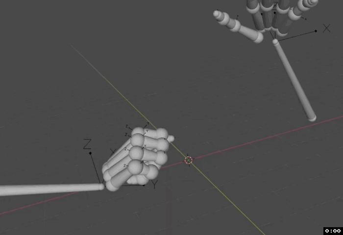

Remember those LeapMotion hand trackers? Well now you can use them to livestream hand mocap into Blender! Even nowadays with AI, Leap trackers are the best hand mocap you can get for the $10-$100 pricerange. Arguably it's even better than mocap gloves which are multiple times that price. Unfortunately the company went out of business, but you can still get a device pretty easily. All you need is some patience on EBay.

The advantage of accellerometer-based devices like gloves over optical devices like Leap, is you don't have to worry about your palm blocking the device from seeing your fingers. However, if you can work around this limitation, there is no better accuracy than optical mocap. You get sub-milimeter precision and no jittering.

Demo below (the GIF is at 10FPS which doesn't do it justice, in reality it's at a smooth 60FPS).

### TODO

* Can't bundle/redistrib the Leap SDK so I have to make an auto-downloader that grabs the SDK from their site. Has to work for Mac/Linux/Windows (pain)
* Make the "possession" code not laggy and fiddly:
  * Don't check every timer update, only check every now and then.
  * Don't check if the hands haven't moved
  * Make it toggleable so that the user doesn't accidentlally possess bones when hovering over them
  * Also make it so that you have to hold-hover over a bone for some interval before possession happens
  * Also make it so that only the "tippiest" bone of each finger is able to possess, before the lower knuckles are allowed to possess.
