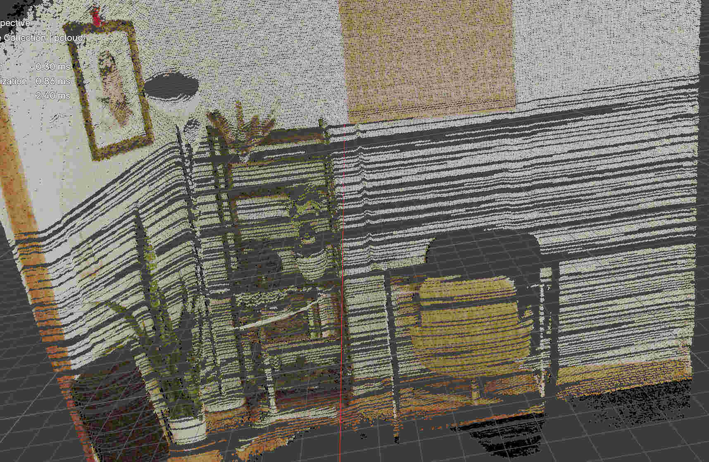

Use an XBox Kinect to stream a 3D pointcloud directly into Blender, live!

The USB bandwidth of a single computer is limited, so I'm making it so that you can send data from Kinects connected to other computers, over a network.

Currently I can stream at about 5FPS. However, there are many optimizations still up for grabs:

* Don't send dead points where xyz==0,0,0. These happen when a surface is too close/far to the Kinect.
* Options to quantize XYZ and RGB data
* Randomly cull some proportion of the points before sending.
* Send info from the receiver (running Blender) to the senders (connected to Kinects) to:
  * Cull outside a camera's frustom
  * Cull outside a certain box area (e.g. to only send a pointcloud of your body and not the walls of the room)
  * Cull points of a certain color (e.g. to precisely cull a room's floor even if it is touching your feet)
* Fix the memory leak in my current implementation...

Overall these optimizations should easily quadruple the FPS at least, so I'm optimistic about being able to livestream pointclouds at high framerates and low performance cost.

Here's a picture of my room streamed into Blender. (The ugly striping will go away once I implement vsync.)

